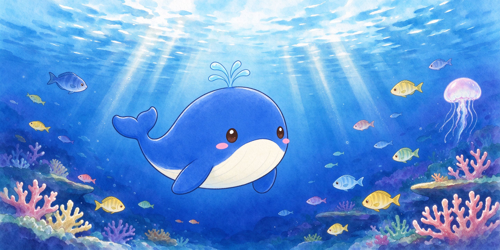
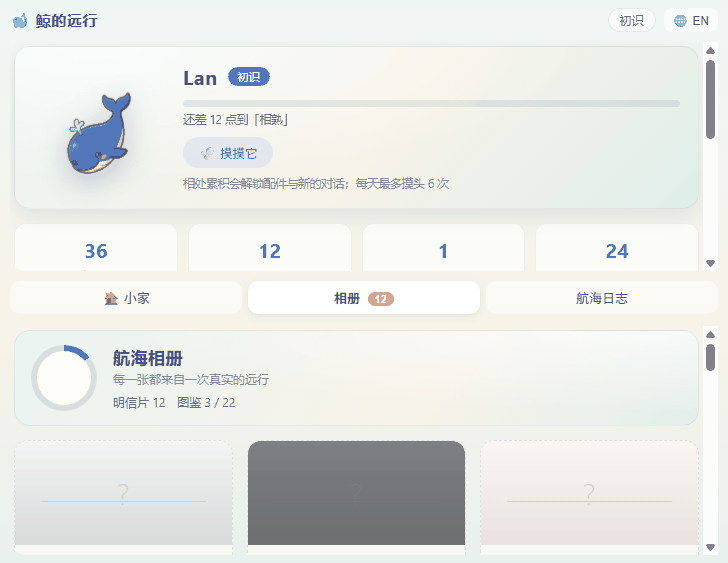
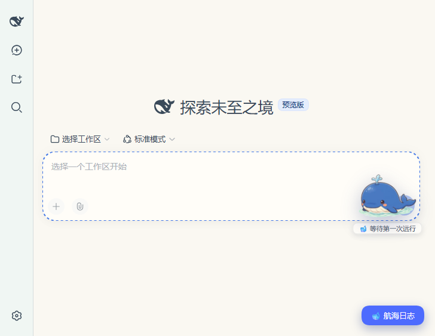
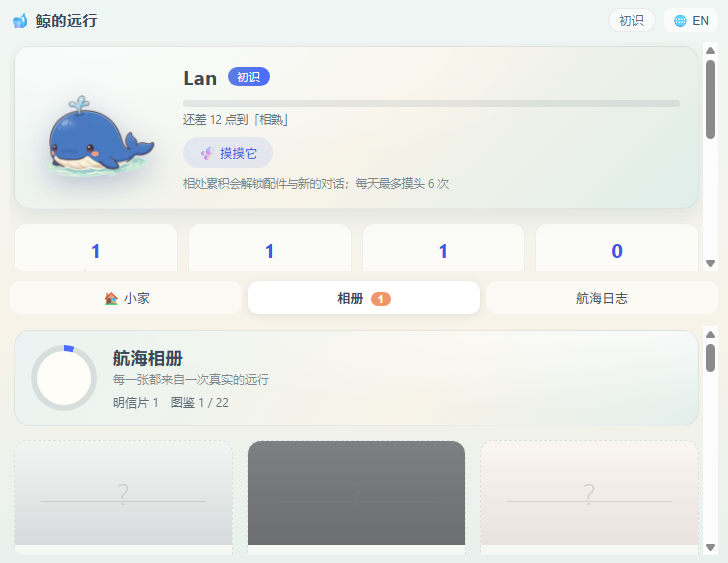

# 🐋 Whale Voyage

<p align="center">
  
</p>

<p align="center">
  <b>你跑 agent 的时候，有只鲸鱼在旁边替你看着海。</b>
</p>

<p align="center">
  
  
  
  
</p>

---

## 这是什么

一个 [DeepSeek Harness](https://github.com/deepseek-ai)（dsh）插件。

你派给 agent 一个任务，少则几分钟多则半小时。这段时间你干嘛？切出去刷手机？还是盯着干巴巴的转圈？

Whale Voyage 在对话区养了一只小鲸鱼。agent 在干活的时候，它就在旁边的海里游——下潜、上浮、甩尾巴。长任务做完了，它会寄回一张明信片，上面印着这次远行的日期、改了几个文件、跑了多久测试。

有点像旅行青蛙，只不过这只青蛙不是在随机旅行，它是真的在陪你工作。

**纯观察者。不注册工具、不注入提示词、不调模型、不花一个 token。** agent 完全不知道它存在。

---

## 效果演示

<p align="center">
  
</p>

| 主界面（右下角飘着鲸鱼） | 相册（明信片图鉴） |
| --- | --- |
|  |  |

---

## 你会看到什么

- **对话区就是海面**——鲸鱼飘在对话里，你可以摸它头、拖着它到处跑
- **下潜 = agent 在干活**——它潜得更深，周围变暗
- **上浮喷水 = 任务做完了**——它冒出头喷个水，庆祝一下
- **长任务寄明信片**——珊瑚苗圃、磷虾集市、洋流赛道、海沟边缘、和海豚同游……每张都是你的工作记录
- **右下角按钮打开相册**——翻看所有明信片，像翻一本航海日志
- **标签页标题和 favicon 实时更新**——切到别的窗口也能看到它是在干活还是在摸鱼
- **授权请求会变成一封"家书"**——轮到你介入的时候它会提醒你

---

## 安装

前置：你已经装好了 dsh。

```bash
# 克隆本项目
git clone https://github.com/wzysbkzsd/dsh-whale-voyage.git
cd dsh-whale-voyage/plugin

# 安装依赖并构建
npm install
npm run build

# 链接到 dsh
dsh plugin link .
```

然后重启 dsh，对话区右下角应该就能看到海面和鲸鱼了。

想先看看效果不想装？启动 dsh 后访问 `http://127.0.0.1:你的端口/whale-voyage?demo=1`，会回放一次完整的航次演示。

---

## 它承诺不做什么

这是我做这个插件时最在意的事，写在这里接受监督：

- **不改 agent 的任何行为**——只听事件，不插手
- **对模型完全隐形**——不注册工具、不注入系统提示词
- **不接管授权流程**——dsh 原生的授权弹窗该怎么弹还怎么弹
- **零 token 消耗**——所有文案都是确定性映射，不调模型
- **出问题不连累 agent**——异常一律吞掉降级，不往 agent 循环里抛
- **一条命令干净卸载**——不留驻留进程、不改写 dsh 文件

---

## 一些设计上的小事

- 明信片不是随机发的——**超过你自己历史时长 70% 的任务**才算"远行"，才会寄明信片。短任务它就捡个贝壳回来。这样不管你任务都是 30 秒还是 30 分钟，体感都是约三成的任务有收获。
- 每张明信片上有**邮戳**——航次序号、日期、改了几个文件、测试过没过。画面可以重复，但记录不会。
- 支持多会话并行——同时跑两个任务，海里就有两只鲸鱼。它们各干各的，不打架。
- 摸头有亲密度，摸多了它会从"初识"慢慢变成"同舟"，还会戴围巾、提灯笼。
- 有个"专业模式"——收起所有动画，变成一行一个航次的状态条。数据照记，只是不展示。

---

## 技术栈

- TypeScript，状态机是纯函数（输入事件序列 → 输出状态）
- 63 个单元测试 + 样本回放 + 混沌测试，全绿
- 前端零框架，原生 DOM + CSS 动画
- 美术资源：立绘是 AI 生成后程序切分，明信片是手绘水彩风

---

## 装不上？可以找我

我做这个插件时踩过的坑，基本就是你会踩的那些：依赖解析卡死、Node 版本过低、端口占用、`MISSING_CREDENTIAL`、插件装完分不清是真生效还是空挂崩溃。

可以按次找我做诊断和落地（每月限 3 单）：[服务说明](./docs/OFFER.md)。我只承诺过程和交付物，不承诺收入或涨粉；不接自动养号、自动刷评论这类需求。

---

## License

[MIT](./LICENSE)

鲸鱼形象基于 DeepSeek 官方鲸鱼的 Q 版粉丝创作，不声称与 DeepSeek 官方存在关联。
